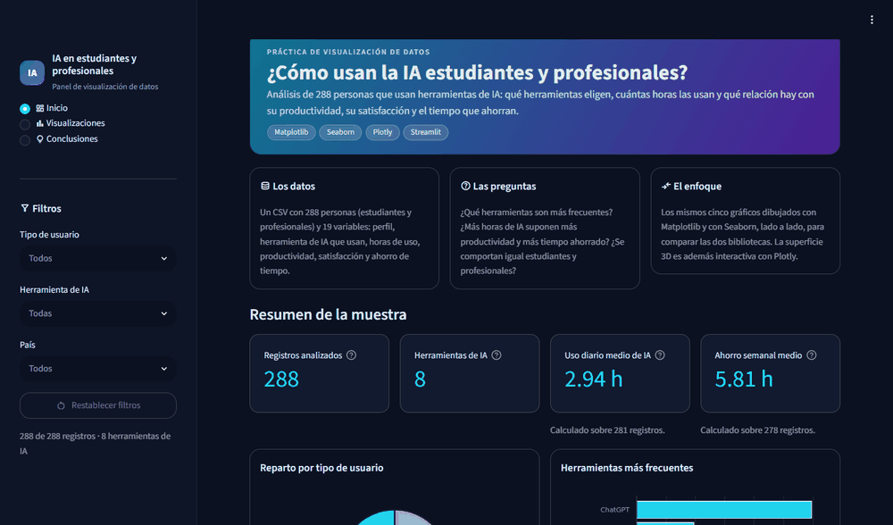
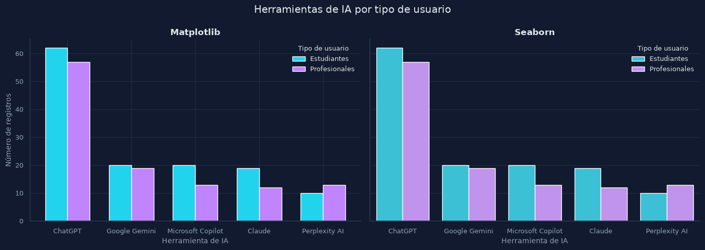
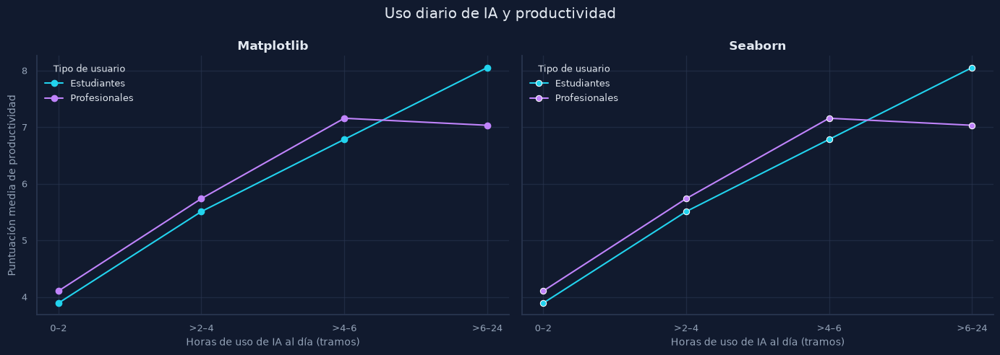
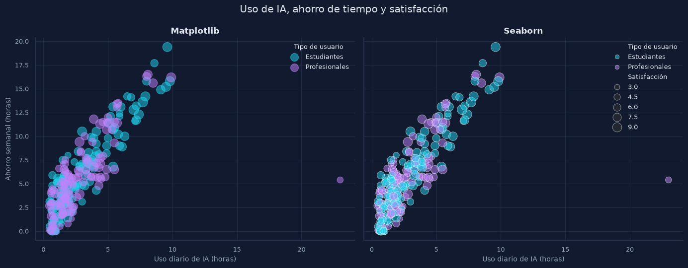
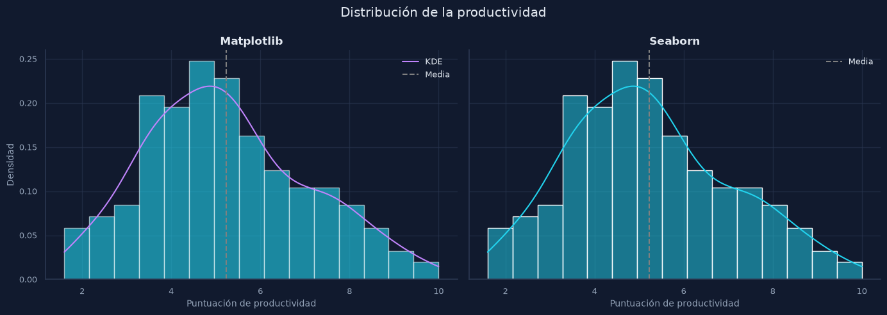
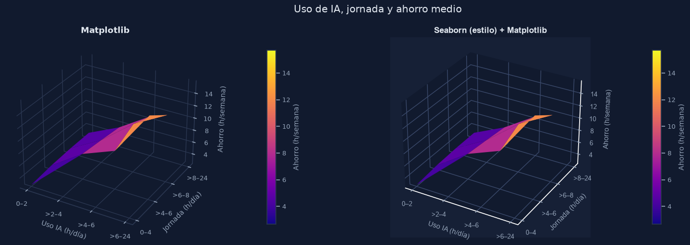

# IA en estudiantes y profesionales

Panel de visualización de datos que analiza cómo usan la inteligencia artificial
estudiantes y profesionales: qué herramientas eligen, cuántas horas las usan y qué
relación hay con su productividad, su satisfacción y el tiempo que ahorran.



## Qué incluye

- **Aplicación Streamlit** (`app.py`) con aspecto de panel de control oscuro: indicadores
  de la muestra, cinco gráficos, conclusiones y filtros.
- **Cuaderno Jupyter** (`proyecto_ia_jupyter.ipynb`) que dibuja los mismos cinco gráficos
  con **Matplotlib y Seaborn lado a lado**, para comparar cómo se prepara y se personaliza
  cada uno. La superficie 3D incluye además una versión interactiva con **Plotly**.

### Filtros

El menú lateral permite filtrar por **tipo de usuario**, **herramienta de IA** y **país**.
Un filtro sin selección equivale a «todas las opciones». Los filtros afectan a los
indicadores, a los gráficos y a las conclusiones, y si una combinación deja pocos
registros, la aplicación lo avisa en lugar de dibujar un gráfico engañoso.

## Cómo ejecutarlo

Requisitos: **Python 3.11 o superior** (probado con 3.14).

Descarga o clona el repositorio y, desde su carpeta, instala las dependencias y lanza
la aplicación:

```bash
python -m venv .venv
# Windows (PowerShell): .venv\Scripts\Activate.ps1
# Linux y macOS:        source .venv/bin/activate
pip install -r requirements.txt
streamlit run app.py
```

Abre la dirección que muestre Streamlit (normalmente `http://localhost:8501`). Hay que
lanzarlo desde la carpeta del proyecto: ahí está `.streamlit/config.toml`, que define el
tema oscuro. En Windows, si `python` abre la Microsoft Store, usa `py` en su lugar.

### Cuaderno

```bash
pip install -r requirements-notebook.txt
```

Después, ábrelo en VS Code (con la extensión de Jupyter) o en JupyterLab y ejecuta las
celdas en orden. El visor de cuadernos de GitHub no muestra el gráfico interactivo de
Plotly; el resto de gráficos sí se ven.

## Estructura del proyecto

```
.
├── app.py                        # Aplicación Streamlit
├── proyecto_ia_jupyter.ipynb     # Cuaderno: Matplotlib frente a Seaborn
├── data/
│   └── AI_Usage_and_Impact_on_Students_and_Professionals.csv
├── assets/                       # Logotipos del pie de página
├── img/                          # Capturas y GIF de este README
├── tests/
│   └── test_app.py               # Pruebas de la aplicación
├── .streamlit/
│   └── config.toml               # Tema oscuro
├── requirements.txt              # Dependencias de la aplicación
├── requirements-notebook.txt     # Añade lo necesario para el cuaderno
├── requirements-dev.txt          # Añade lo necesario para las pruebas
└── LICENSE
```

`app.py` y el cuaderno se pueden leer de principio a fin, sin módulos auxiliares.

## Datos

Los datos proceden del dataset
[AI Usage and Impact on Students & Professionals](https://www.kaggle.com/datasets/eishatuzzuhra/ai-usage-and-impact-on-students-and-professionals)
de Eisha Tuz Zuhra, publicado en Kaggle con licencia **CC0 (dominio público)**. El CSV
está incluido en `data/`, así que no hace falta descargarlo.

Tiene 300 filas y 19 columnas: perfil del usuario (edad, género, país, tipo de usuario,
nivel educativo, profesión, ingresos), uso de la IA (herramienta, finalidad, horas
diarias, tareas, coste mensual) y resultados (productividad, precisión, satisfacción,
ahorro semanal de tiempo, horas de trabajo o estudio y si la recomendaría).

### Preparación

1. Se eliminan 12 duplicados exactos: quedan **288 registros**.
2. Las tres columnas de horas, que mezclan valores como `2 hrs` y `2`, se convierten a
   números.
3. Se unifican los nombres de las herramientas (por ejemplo, `chat gpt` y `ChatGPT`).

El resto de las columnas se conserva tal como aparece en el CSV. No se rellenan valores
ausentes ni se eliminan extremos, como un registro con 23 horas diarias de IA. Cada
gráfico usa solo las columnas que necesita e indica cuántos registros representa. Los
países, escritos de varias formas en el CSV (`brazil` y `Brazil`), se unifican únicamente
para el filtro.

### Limitaciones

Las conclusiones describen este archivo y no demuestran causalidad. El método de
muestreo y las escalas de las puntuaciones no están documentados, y los grupos tienen
tamaños distintos.

## Gráficos

Cada gráfico muestra **Matplotlib a la izquierda y Seaborn a la derecha**, con los mismos
datos y ejes compartidos. Las imágenes están generadas con el código de la aplicación,
que usa colores algo más claros que el cuaderno para leerse bien sobre fondo oscuro.

#### 1. Barras agrupadas
Las cinco herramientas más frecuentes por tipo de usuario.



#### 2. Líneas múltiples
Productividad media por tramos de uso diario de IA (los tramos no son fechas).



#### 3. Burbujas
Uso diario, ahorro semanal y satisfacción (tamaño de la burbuja).



#### 4. Histograma con densidad
Distribución de las puntuaciones de productividad con su curva KDE.



#### 5. Superficie 3D
Ahorro semanal medio según el uso de IA y la jornada de trabajo o estudio, con un mínimo
de tres observaciones por combinación. Matplotlib y Seaborn (que solo aporta el estilo)
van lado a lado, y debajo hay una versión interactiva con Plotly que se puede girar.



## Pruebas

Las pruebas recorren las secciones, los cinco gráficos y distintas combinaciones de
filtros, incluidos los casos con pocos o ningún registro. No necesitan navegador:

```bash
pip install -r requirements-dev.txt
python -m pytest
```

## Licencia y autoría

Proyecto de Guillermo Redondo Camacho, realizado en el Máster de IA y Big Data.

El código se distribuye bajo la licencia [MIT](LICENSE). El dataset es de dominio público
(CC0) y pertenece a su autora original. Los logotipos de `assets/` pertenecen a sus
titulares y no están cubiertos por la licencia del código.
